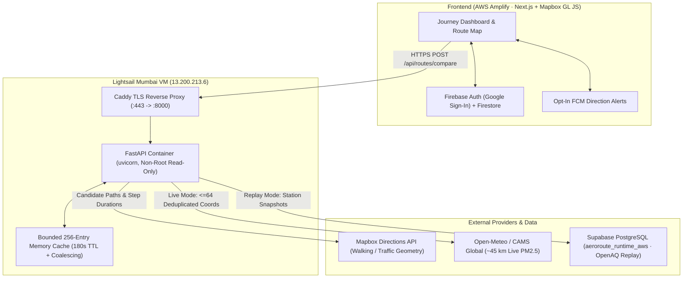
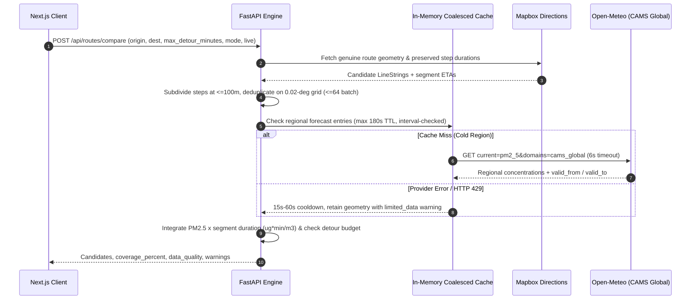

# AeroRoute - Exposure-Aware Route Comparison Engine

> [!IMPORTANT]
> Source documentation and architecture specs live in [Shubh3155/AWS-DTU](https://github.com/Shubh3155/AWS-DTU). AeroRoute compares walking, driving, and motorcycle route candidates using estimated PM2.5 exposure (`ug*min/m3`) constrained by a user-defined detour time budget.

## Problem & Core Capabilities

Standard navigation engines minimize distance or ETA while remaining blind to ambient particulate exposure along busy corridors. **AeroRoute** bridges live routing geometry with regional air-quality telemetry and historical replay validation:

- **Genuine Multi-Candidate Routing**: Fetches live walking and traffic-aware geometry from Mapbox Directions and evaluates detour eligibility strictly against `max_detour_minutes`.
- **Dual Telemetry Modes**: Defaults to **Live Mode** (Open-Meteo / Copernicus CAMS Global PM2.5 forecasts along route corridors) while supporting **Replay Mode** against curated Supabase / OpenAQ Delhi station snapshots.
- **Explicit Credibility Guardrails**: Surfaces `coverage_percent`, `limited_data`, and `uncertain_difference` states transparently rather than interpolating past grid bounds or fabricating reduction claims.
- **Session & Navigation Suite**: Includes Google Sign-In via Firebase Auth, private Firestore recent-route persistence, and opt-in FCM direction alerts.

## Fullstack & Cloud System Architecture



## Live Exposure Scoring & Caching Sequence

When `data_mode` is `live`, AeroRoute bypasses database pollution reads and scores each candidate path directly from regional forecast intervals with strict timeout and negative-cache protections.



## Implemented API Contract

| Endpoint | Method | Purpose | Error / Edge Handling |
|---|---|---|---|
| `/health` | `GET` | Process liveness & version check | Works without provider keys |
| `/api/pilot` | `GET` | Central Delhi historical demo polygon | Labels `historical_demo` boundary |
| `/api/routes/compare` | `POST` | Compares candidates by time budget & PM2.5 | `503` if Mapbox unconfigured, `422` strict validation |

Example comparison request payload (`backend/app/schemas/routes.py`):

```json
{
  "origin": { "lat": 28.6139, "lng": 77.2090 },
  "destination": { "lat": 28.6200, "lng": 77.2200 },
  "max_detour_minutes": 5,
  "mode": "walking",
  "data_mode": "live"
}
```

## Repository Structure & AWS Deployment

```text
AWS-DTU/
├── frontend/            # Next.js, TypeScript, Tailwind CSS, Mapbox GL JS
├── backend/             # FastAPI, exposure model, Supabase runtime_role.sql, Docker
├── .github/workflows/   # CI checks, Playwright E2E, deploy-backend-vm.yml
└── documentations/      # API_CONTRACT.md, LIVE_AIR_QUALITY.md, AWS_VM_DEPLOYMENT.md
```

| Layer | Implementation Details |
|---|---|
| **Frontend Hosting** | AWS Amplify serving `aeroroute` branch auto-synced from `main` |
| **Backend Hosting** | Ubuntu 24.04 Lightsail VM in Mumbai (`ap-south-1`) behind Caddy auto-TLS |
| **Container Hardening** | Non-root user, read-only root filesystem, private temp mount, automatic rollback |
| **Database Scoped Role** | `aeroroute_runtime_aws` with RLS read-only access to stations/snapshots |
| **Automated Checks** | Frontend ESLint, `tsc`, Playwright desktop/mobile E2E, Python `ruff` + `pytest` |
