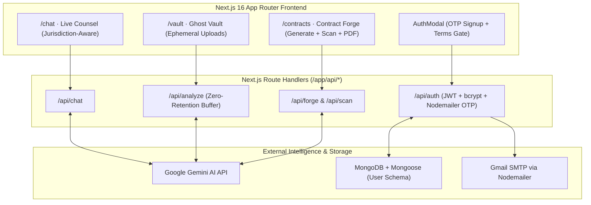
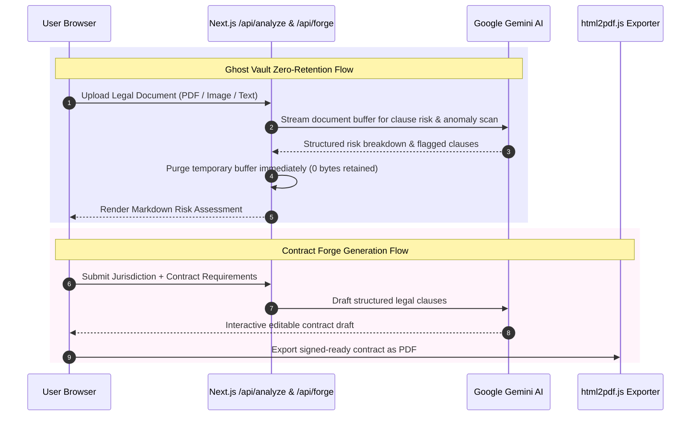

# Amicus AI - Jurisdiction-Aware Legal Consultation Platform

> [!WARNING]
> AMICUS.AI is an informational AI assistant, not a licensed attorney. All strategic outputs include explicit legal-disclaimer framing requiring human counsel verification before executing binding agreements.

## Overview

**Amicus AI** is a fullstack legal intelligence workspace built with **Next.js 16 (App Router)**, **Google Gemini AI**, **MongoDB**, and **Tailwind CSS v4**, delivering three specialized workflows inside a responsive dark-navy and gold interface.

## Fullstack Platform Architecture



## Core Workflows: Ghost Vault & Contract Forge

Ghost Vault enforces a **zero-retention privacy boundary** for sensitive PDFs, images, and text contracts: files are inspected in memory by Gemini for clause risk and fraud indicators and immediately discarded without persistent storage.



## Tech Stack Breakdown

| Layer | Technology | Role in System |
|---|---|---|
| **Web Framework** | Next.js 16 App Router | Unified SSR UI and `/api/*` backend endpoints |
| **LLM Reasoning** | Google Gemini AI | Jurisdiction-scoped legal counsel, contract drafting & clause audit |
| **Database** | MongoDB + Mongoose | User identity records and terms-acceptance state (`models/User.ts`) |
| **Authentication** | JWT + `bcrypt` + Nodemailer | Email OTP verification and session token issuance |
| **UI & Motion** | Tailwind CSS v4 + Framer Motion | 3D prism canvas background and responsive navigation drawer |
| **Document Export** | `html2pdf.js` | Instant downloadable PDF rendering from Contract Forge output |

## Directory Structure

```text
gemini-hackahton/
├── app/
│   ├── api/              # auth/, chat/, analyze/, forge/, scan/
│   ├── chat/             # Live Counsel workspace
│   ├── vault/            # Ghost Vault zero-retention analyzer
│   ├── contracts/        # Contract Forge & scanner
│   └── about/, terms/    # Governance & legal disclaimers
├── components/           # AuthModal, Navbar, Sidebar, Contact
├── models/User.ts        # Mongoose User model
└── lib/                  # db.ts & auth.ts JWT utilities
```
