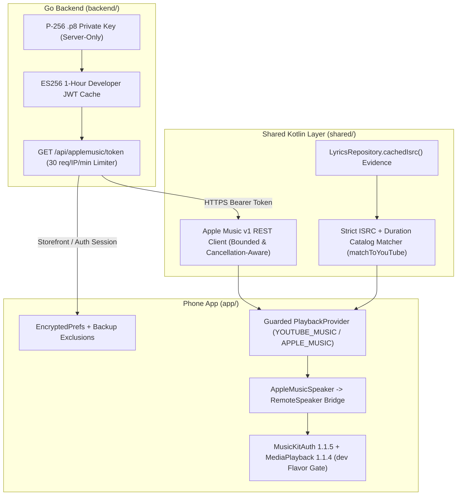
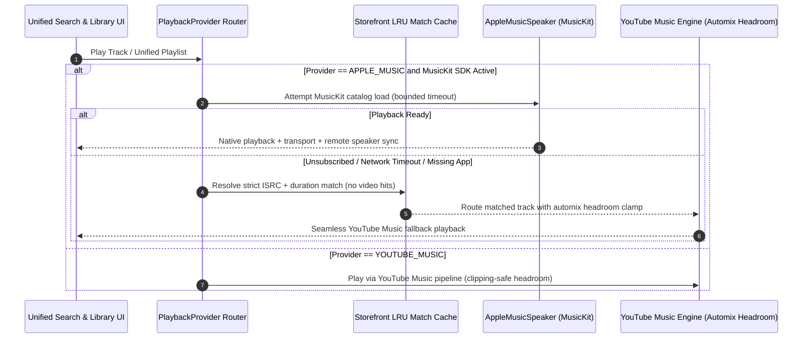

# BitChord - Apple Music Integration (#1222) & Multi-Provider Routing

> [!NOTE]
> Authored across **8 structured commits** spanning a **Go token-minting backend**, **Kotlin shared metadata/catalog layers**, **Android encrypted session management**, and **native MusicKit playback routing**, while resolving automix clipping headroom.

## Overview

BitChord is a modern Kotlin YouTube Music client with Apple Music-inspired aesthetics. PR [#1414](https://github.com/kushagrasinghx/BitChord/pull/1414) introduces end-to-end support for **Apple Music** alongside YouTube Music via a guarded `PlaybackProvider` abstraction, strict ISRC cross-catalog matching, and automatic playback fallback.

## Cross-Stack Provider & Token Architecture

## Guarded Playback Routing & Automatic Fallback

To protect playback reliability across free, unsubscribed, or disconnected states, BitChord routes tracks through `PlaybackProvider` with deterministic markers (`am:` pending, `am-miss:<catalogId>`) and transparent YouTube Music fallback.

## Commit Architecture Breakdown

| Commit | Layer | Implemented Behavior |
|---|---|---|
| `f94d1704` | `backend/` | ES256 developer-token signing, in-memory refresh cache, 30 req/IP/min rate limiter, `503` safe errors |
| `e47c1a89` | `shared/` | Bounded HTTPS `api.music.apple.com/v1/` REST APIs, typed models, `LyricsRepository.cachedIsrc()` |
| `ba41319e` | `app/` | `EncryptedPrefs` token storage, backup exclusions, MusicKitAuth storefront resolution |
| `74bd67fe` | `app/` | Storefront-scoped persistent LRU cache, playlist/library browsing, strict `matchToYouTube` imports |
| `713797f7` | `app/` | Optional MusicKit AAR adapters, R8 keep rules, `dev` build gates keeping `prod`/TV safely stubbed |
| `68a8361b` | `playback/` | `AppleMusicSpeaker` `RemoteSpeaker` controls, fallback toggle, **automix clipping headroom fix** |
| `7b372508` | `ui/` | Account connection UI, provider controls, unified deduplicated search |
| `40a6c63d` | `docs/ci` | `docs/APPLE_MUSIC.md`, pnpm setup fix, `workflow_dispatch` branch CI triggers |

## Security & Verification Gates

- **Zero Client Secrets**: The ES256 `.p8` key never leaves the Go server; `APPLE_MUSIC_TOKEN_URL` requires HTTPS and exact `/api/applemusic/token` path validation.
- **Automated Test Suites**:
  - `./gradlew :shared:jvmTest :app:testDevDebugUnitTest :app:assembleDevDebug --console=plain`
  - `cd backend && go test -race ./... -count=1 -timeout=90s`
  - Instrumentation check `MusicKitRuntimeTest` compiled against AAR pair and verified with `zipalign -c -P 16 4`.
