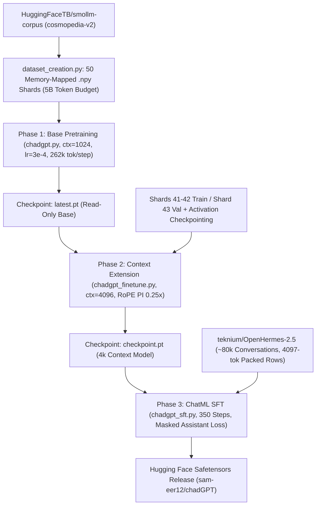

# ChadGPT - 250M Instruction-Tuned Language Model

> [!NOTE]
> Built and trained from scratch without Hugging Face `AutoModelForCausalLM` abstractions. The custom PyTorch implementation ships standalone weights (`model.safetensors`), Tiktoken merge ranks, and a KV-cached decoding runtime.

## Overview

**ChadGPT** is a **249,832,448-parameter decoder-only language model** built as the flagship deliverable of [sam-eer12/projectSLM](https://github.com/sam-eer12/projectSLM). The repository tracks a complete progression from raw PyTorch tensor mechanics and Graph Neural Networks (`DL/`) to a three-stage pretraining, long-context extension, and ChatML supervised fine-tuning pipeline (`SLM/`).

## Transformer Block & Attention Topology

ChadGPT combines **Pre-LayerNorm**, **Grouped Query Attention (GQA)** with a 4:1 query-to-KV ratio, **Rotary Position Embeddings (RoPE)** with Position Interpolation, and **tied input/output embeddings** to minimize parameter overhead across 18 transformer blocks.

```mermaid
flowchart LR
  Tokens["Input Token IDs (50,259 Vocab)"] --> Emb["Tied Token Embeddings (dim=1024)"]
  Emb --> Norm1["Pre-LayerNorm (eps=1e-5)"]
  Norm1 --> QKV["QKV Projections (16 Query Heads / 4 KV Heads)"]
  QKV --> RoPE["RoPE (base=10000, PI scale=0.25)"]
  RoPE --> GQA["Causal Grouped Query Attention + KV Cache"]
  GQA --> Res1["Residual Add"]
  Norm1 -.-> Res1
  Res1 --> Norm2["Pre-LayerNorm"]
  Norm2 --> FFN["MLP Feed-Forward (1024 -> 4096 GELU -> 1024)"]
  FFN --> Res2["Residual Add (x18 Transformer Blocks)"]
  Res1 -.-> Res2
  Res2 --> FinalNorm["Final LayerNorm"]
  FinalNorm --> Head["Tied LM Head Logits (tok_emb.weight.T)"]
```



## 3-Stage Training Workflow

Training executed across two NVIDIA T4 GPUs using **Hugging Face Accelerate** in FP16 mixed precision, cosine learning-rate decay with linear warmup, and activation checkpointing during the 4k context phase.



## Architecture & Hyperparameters

| Property | Specification | Engineering Purpose |
|---|---|---|
| Trainable Parameters | 249,832,448 (~250M) | Compact footprint for T4 / consumer inference |
| Transformer Layers | 18 Decoder Blocks | Deep representation without excessive latency |
| Hidden Dimension | 1,024 | Balanced width across attention and MLP |
| Feed-Forward Dimension | 4,096 (GELU) | 4x expansion ratio |
| Attention Heads | 16 Query / 4 KV (head dim 64) | Grouped Query Attention cuts KV cache 4x |
| Positional Encoding | RoPE (base 10,000, PI 0.25) | Smooth extrapolation from 1,024 to 4,096 tokens |
| Vocabulary Size | 50,259 (GPT-2 BPE + 2 ChatML) | Preserves base GPT-2 IDs cleanly |
| Weight Tying | Enabled | Shares token embedding matrix with LM head |
| Dropout / dtype | 0.0 / FP32 Release | Deterministic evaluation & preserved weights |

## ChatML Tokenizer Extension

The base GPT-2 BPE tokenizer (`50,257` tokens) was extended via `SLM/chatml_tokenizer.py` without altering existing merge ranks or token indices:

| Token | ID | Function |
|---|---|---|
| <code>&lt;&#124;endoftext&#124;&gt;</code> | `50256` | Document separator & sequence padding during packing |
| <code>&lt;&#124;im_start&#124;&gt;</code> | `50257` | Delimits start of `system`, `user`, or `assistant` turn |
| <code>&lt;&#124;im_end&#124;&gt;</code> | `50258` | Turn terminator & autoregressive generation stop token |

During Phase 3 SFT (`SLM/prepare_openhermes_sft.py`), conversations across coding, mathematics, reasoning, STEM, writing, roleplay, and multilingual tasks are packed into `4,097`-token rows. Document-boundary position resets prevent cross-conversation attention leakage, while cross-entropy loss is masked strictly to assistant tokens and their closing `<|im_end|>` marker.

## Evaluation & Benchmarks

Evaluated zero-shot with **LM Evaluation Harness 0.4.13** on the full **2,376-question ARC-Easy** test split:

| Benchmark Metric | Score | Notes |
|---|---|---|
| ARC-Easy Accuracy (Zero-Shot) | **42.55%** | Full 2,376-question test split |
| ARC-Easy Length-Normalized | **41.37%** | Zero-shot completion likelihood |
| Decoding Complexity | **O(T)** per sequence | Custom KV cache in `modeling_chadgpt.py` |

## Quickstart & Python Inference

```bash
hf download sam-eer12/chadGPT --local-dir chadGPT
python -m pip install -r chadGPT/requirements.txt
python chadGPT/inference.py \
  --prompt "Write a Python function that checks if a string is a palindrome." \
  --max-new-tokens 256 --temperature 0.7 --top-k 40
```

```python
import sys
sys.path.insert(0, "chadGPT")
from inference import load_model, chat

model, tokenizer = load_model("chadGPT", device="auto")
print(chat(model, tokenizer, "Explain grouped-query attention in simple terms."))
```

## Deep Learning & GNN Foundations (`projectSLM`)

Beyond ChadGPT, `sam-eer12/projectSLM` documents foundational PyTorch architectures:
- `DL/book1.ipynb` - `book5.ipynb`: Tensor allocation, `nn.Module` workflows, decision boundaries, FashionMNIST CNNs, and custom `Dataset` pipelines.
- `DL/gnn.ipynb`: Multi-layer Graph Convolutional Networks (PyTorch Geometric) on the Cora citation graph.
- `DL/gnn_mp.ipynb`: Custom `CustomMPNNLayer` Message-Passing Neural Network for molecular property regression on QM9.
