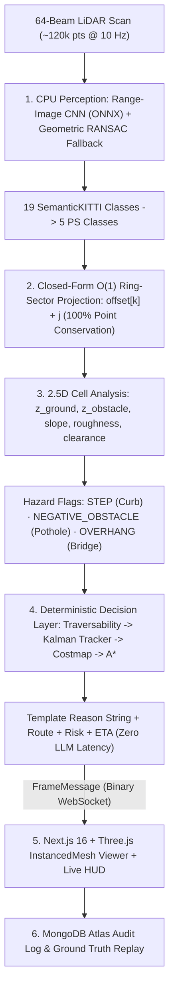
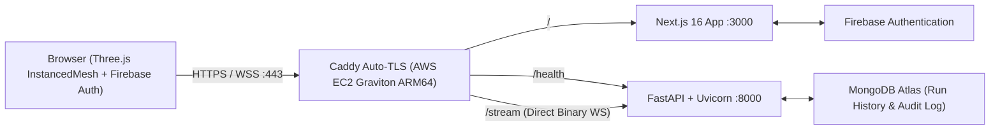

# NEXA (AVR-25D) - Adaptive Variable-Resolution 2.5D LiDAR Mapping

> [!IMPORTANT]
> Built by **Team KANVSS** for **Smart India Hackathon 2026 (DRDO / iDEX Problem Statement 26053 - Smart Vehicles)**. Every published number regenerates deterministically from `make bench` into `results.json` and `docs/RESULTS.md`, verified by **382 automated tests**.

## Why 2.5D Foveated Mapping?

A 64-beam LiDAR streams ~120,000 points per revolution at 10 Hz (~1.2 million points/sec). Standard representations break down on embedded vehicle compute:
- **Full 3D Voxel Grids**: Too expensive to close the control loop in real time on CPU.
- **Flat 2D Occupancy Grids**: Discard elevation entirely, collapsing curbs, potholes, and 3.1m overhead bridges into identical occupied bits.

**NEXA (AVR-25D)** mirrors human foveated vision across **662 concentric rings (705,771 isotropic cells)**: high-precision **5 cm cells within 10 m** where braking decisions occur, smoothly scaling to **50 cm cells at 100 m** to match physical beam divergence.

## Real-Time Perception & Deterministic Decision Pipeline

## Production Deployment Architecture (AWS Graviton)

The browser establishes a direct binary WebSocket to FastAPI via Caddy, bypassing Next.js SSR hops so 10 Hz point-cloud frames are never buffered or JSON re-serialized.

## Reproducible Benchmarks (`SemanticKITTI seq 04, 271 Scans`)

### Representation & Memory Footprint

| Metric | B1 Dense Uniform 2.5D | B4 Sparse 3D Voxel | AVR-25D (NEXA) | Advantage |
|---|---|---|---|---|
| Total Grid Cells (360 deg x 100 m) | 16,000,000 | Unbounded | **705,771** | **22.67x fewer cells** |
| Occupied Cells / Frame | 71,419 | 84,840 | **58,310** | Minimal downstream work |
| Bytes / Frame | 400.0 MB | 1.018 MB | **17.64 MB dense** | Pre-allocated O(1) table |
| Points Conserved / Dropped | N/A | N/A | **100.000% / 0** | Zero ring-boundary loss |

### Pipeline Stage Latency (266 Scored Scans, CPU-Only)

| Stage | Mean (ms) | Median (ms) | p95 (ms) |
|---|---|---|---|
| Read | 4.6 | 4.7 | 5.2 |
| Segment | 132.9 | 124.2 | 160.5 |
| Score & Map | 14.5 | 13.7 | 16.6 |
| **End-to-End** | **152.0** | **142.2** | **178.3** |

### Multi-Hazard Ground Truth Preservation vs 2D Grid

| Synthetic Scene | Hazard Feature | True Value | NEXA Measured | Error | Standard 2D Grid Failure |
|---|---|---|---|---|---|
| `S1_flat_road` | False Positives | 0.00 | **0.0000** | 0.0000 | Baseline control (0 / 64,559 cells) |
| `S2_pothole` | Pothole Depth | 0.22 m | **0.2092 m** | 0.0108 m | Byte-identical to flat road (missed) |
| `S3_overhang` | Overhead Clearance | 3.10 m | **3.0976 m** | 0.0024 m | Marks drivable road impassable |
| `S4_curb` | Curb Step Height | 0.15 m | **0.1526 m** | 0.0026 m | Same occupied bit as a 3 m wall |
| `S5_crossing_truck` | Tracked Speed | 8.00 m/s | **7.5660 m/s** | 0.4340 m/s | Position only, no height context |
| `S6_occluded_pothole` | Grazing Pit Depth | 0.22 m | **0.2248 m** | 0.0048 m | Invisible (0.000 cells blocked) |
