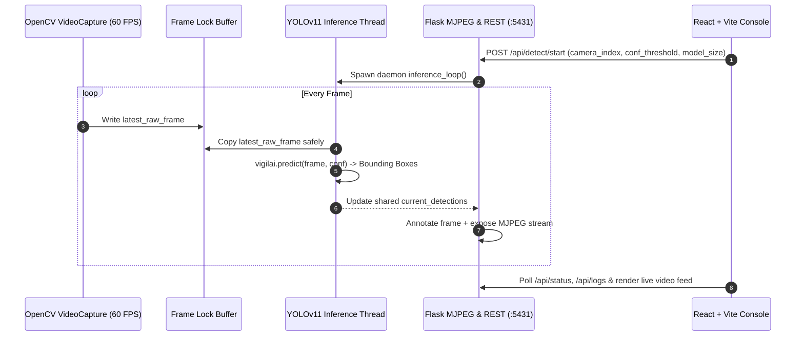
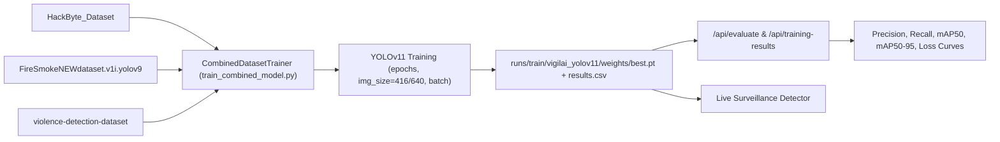

# VigilAI - YOLOv11 Multi-Threat Surveillance Platform

> [!NOTE]
> Combines custom multi-dataset YOLOv11 object and hazard detection with a decoupled multi-threaded OpenCV capture pipeline, Flask REST/MJPEG backend (`:5431`), and React + TypeScript monitoring console (`vigilai-ui/`).

## Overview & Threat Taxonomy

VigilAI supports both standard safety-equipment models and a unified **8-class combined surveillance model** trained across three merged datasets (`HackByte_Dataset`, `FireSmokeNEWdataset`, and `violence-detection-dataset`):

| Dataset Source | Detected Classes | Bounding Box Encoding |
|---|---|---|
| **HackByte Safety** | `FireExtinguisher`, `ToolBox`, `OxygenTank` | Red / Blue / Green overlays |
| **Fire & Smoke** | `fire`, `smoke`, `other` | Orange-Red / Gray / Cyan overlays |
| **Behavioral Safety** | `violence`, `non-violence` | Dark Red alert / Green clearance |

## Asynchronous Capture & Inference Architecture

To prevent blocking PyTorch forward passes from stalling the live webcam feed, `flask_api.py` isolates camera frame acquisition, YOLOv11 inference, and MJPEG HTTP streaming across lock-synchronized threads.



## Multi-Dataset Training & Evaluation Pipeline



## Model Variant Profiles

`/api/models` introspects trained checkpoints and exposes parameter scale and CPU inference latency telemetry to the UI:

| Checkpoint Variant | Parameters | CPU Latency | Primary Tradeoff |
|---|---|---|---|
| `yolo11n.pt` (Nano) | 2.6M | ~1.2 ms | Maximum frame throughput on edge CPUs |
| `yolo11s.pt` (Small) | 9.4M | ~2.1 ms | Balanced speed and recall |
| `yolo11m.pt` (Medium) | 20.1M | ~4.5 ms | Default VigilAI deployment checkpoint |
| `yolo11l.pt` (Large) | 25.3M | ~6.8 ms | Higher precision for dense scenes |
| `yolo11x.pt` (X-Large) | 48.1M | ~12.3 ms | Peak detection fidelity |

## Flask REST Control Plane

| Endpoint | Method | Role |
|---|---|---|
| `/api/status` | `GET` | Reports `Idle`, `Training`, or `Detecting` state |
| `/api/logs` | `GET` | Streams ring-buffered timestamped training & detection logs |
| `/api/train` | `POST` | Starts standard or combined 3-dataset training thread |
| `/api/detect/start` | `POST` | Launches multi-threaded camera capture & YOLOv11 prediction |
| `/api/training-results/<path>` | `GET` | Parses `results.csv` epoch metrics (`mAP50`, box/cls/dfl losses) |
| `/api/evaluation-results/<path>` | `GET` | Returns saved `results.json` evaluation benchmarks |

## CLI & Programmatic Usage

```bash
# Extract dataset, train combined model, and start live detection
python vigilai.py --mode extract
python vigilai.py --mode train --epochs 100 --batch 32 --img-size 640
python vigilai.py --mode detect --model runs/train/vigilai_yolov11/weights/best.pt --conf 0.6
```

```python
import cv2
from vigilai import VigilAI

vigilai = VigilAI(use_combined_model=True)
vigilai.load_model("runs/train/vigilai_yolov11/weights/best.pt")
annotated_frame, detections = vigilai.detect_objects(cv2.imread("sample_frame.webp"))
```
